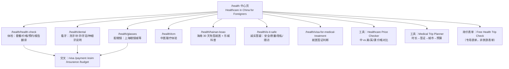
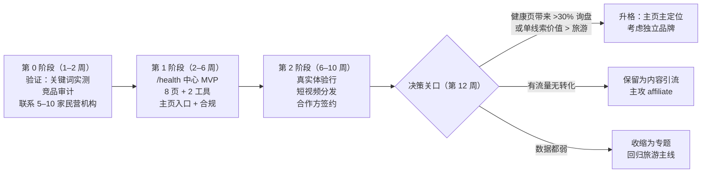

# 赴华医疗（Health in China）战略研判与落地方案

> 编写时间：2026-10-28 ｜ 适用项目：BeforeChina（beforechina.com）
> 背景问题：中国旅游赛道强势竞品多，是否以「去中国看病/医疗」为突破口——整体迁移、做落地页，还是在主页突出？
> 数据说明：市场数据来自网络检索（来源见文末），部分为二手/行业估算，**关键词搜索量尚未用 DataForSEO 实测**，第 7 节列出了验证步骤。

---

## 0. 一句话结论

> [!IMPORTANT]
> **方向对，但不要「整体迁移」，也不要做「医疗中介」。**
> 正确的打法是：以 **低风险、强传播的「轻医疗」**（体检、洗牙/补牙/牙冠、配眼镜、中医理疗）作为 **楔子**，在 `/health` 下建一个独立的内容 + 工具 + 询价中心，主页只加一个显眼入口；用 8–12 周的数据决定是否把它升格为主定位。
> 手术、肿瘤、种植牙这类 **重医疗** 暂不碰，等有了真实合作方和医学审核再说。

你的直觉有三点是对的：需求真实在涨、旅游主赛道太挤、「医疗」比「风景」更有支付意愿。
但有三点需要修正：**医疗赛道本身已经开始变挤**、**医疗内容是 Google 的 YMYL 高压区**、**英国广告法明确禁止把手术包装成「度假」**——这三点决定了不能简单地「换个主题照搬旅游站的打法」。

---

## 1. 论据：支持「赴华医疗」的证据（是真的在涨）

| 维度           | 证据                                                                                                                                                        | 可信度               |
| -------------- | ----------------------------------------------------------------------------------------------------------------------------------------------------------- | -------------------- |
| 官方体量       | 国家卫健委口径：2025 年重点涉外医院接诊国际患者 **约 128 万人次**，三年增长约 **73.6%**；其中专程赴华就医者估算 40 万+（注意：人次 ≠ 人数，含在华外籍人士） | 中（口径偏宽）       |
| 上海           | 2025 年上海公立医院外籍护照就诊约 **7.3 万人次**；上海已在华山、瑞金、中山等三甲医院开展**国际医疗旅游试点**，并制定国际医疗服务地方标准                    | 中高                 |
| 海南           | 约 61 国公民（含英美加澳及多数欧洲国家） **30 天免签入境海南，「就医」明确列为允许事由**；博鳌乐城可用「国外已上市、国内未上市」的特许药械                  | 高（国家移民局口径） |
| 政策顶层       | 商务部等多部委文件提出「探索建设国际医疗旅游集聚区，提供高端体检、整形、康复、中医药服务」                                                                  | 高                   |
| 社媒传播       | TikTok/YouTube 上「在中国花 \$X 做 MRI/洗牙/体检」类视频大量走红；出现「旅行新三件套：**配眼镜 + 中医理疗 + 看牙**」的说法；上海眼镜城成为 TripAdvisor 景点 | 高（现象层面）       |
| 价格差         | 体检：上海三甲国际部约 \$250–700 vs 美国数千美元；种植牙：集采后国内公立约 ¥6,000–7,000/颗 vs 英国 £2,000–3,500；MRI 约 \$70–200 vs 美国 \$1,000–3,000      | 中高                 |
| 需求侧（英国） | NHS 牙科危机：40–50% 成年人难以获得 NHS 牙医；每年 **60–70 万英国人出国看牙**（主要去土耳其、匈牙利）                                                       | 中高                 |
| 需求侧（美国） | 高免赔额 + 医疗账单焦虑，「health-cation」叙事在美国社媒有共鸣                                                                                              | 中                   |

**结论：需求端是真的，且有政策 + 社媒 + 价格差三重推力。这不是伪命题。**

---

## 2. 反方论据：必须正视的六个风险（这是决定打法的关键）

### 2.1 医疗赛道已经不是蓝海

2025–2026 年冒出了一大批英文「赴华就医」站：`chinamedpass`、`medorachina`、`chinacurelink`、`sinocarelink`、`medchinaguide`、`haiyingmed`、`tophealchina`、`verifiedchinacare`、`chinamedservices`、`medtourchina`、`chinamedwaypoint`、`tochinacare`、`medbridgenz`、`chinamedical.ca`……外加 Bookimed、Vaidam 这类全球平台的中国频道。

- **特点**：大多数是中国团队 + AI 批量内容 + 「我们对接三甲」的中介话术，同质化严重，**缺乏真实体验和价格透明度**。
- **含义**：这和你一年前面对旅游赛道的格局几乎一样——**真正的错位点不是「医疗」这个主题，而是「可信」这个身份**。

### 2.2 YMYL：Google 对医疗内容的 E-E-A-T 要求极高

- 医疗属于 Your Money or Your Life 类别。新站 + **虚构人设**（handover 里已标注 "Richard Du" 人设尚未落地为真实经历）在旅游内容里是风险，在医疗内容里是**致命伤**。
- 必须有：真实作者、真实就诊经历、可核查的价格来源、医学审核声明（Medically reviewed by…）。

### 2.3 英国 ASA/CAP 广告规则

- ASA 多次裁定：**把手术与观光、圣诞市场、度假打包宣传属于「轻视手术」，违规**。
- 「Safe surgery」「risk-free」「guaranteed」等绝对化用语受限；对合作医院资质的描述必须可证实（如 JCI）。
- 这直接冲突于现在站点的「奢华定制旅行」调性——**不能做「Luxury Dental Holiday in China」这种页面**。

### 2.4 Google Ads 医疗政策

- 不能基于健康状况做再营销/人群定向；医疗类落地页审核严格。
- 前期主要靠 SEO + 社媒，而非付费广告（和 VPN 类似）。

### 2.5 中国侧合规：公立医院不能给你返佣

- 公立医院（含国际医疗部/特需部）向中介支付「转诊佣金/介绍费」属于**商业贿赂红线**。
- 含义：**变现不能指望公立三甲返佣**。可行路径是：①向患者收透明服务费；②与**民营**机构（如嘉会、和睦家、瑞尔/马泷等民营齿科连锁、眼镜店、中医馆）签正规市场推广合同；③保险等 affiliate。

### 2.6 责任与信任

- 并发症、术后随访、回国后无人接手（英国牙医协会多次发声：大量海外治疗的并发症由英国牙医收拾）。
- 西方对中国的数据隐私/医疗质量疑虑真实存在。**正面回应这些疑虑本身就是最好的内容**（"Is it safe to get dental work in China? An honest answer"）。

---

## 3. 核心判断：四个选项对比

| 选项                                 | 描述                                                | 评估                                                                                                         |
| ------------------------------------ | --------------------------------------------------- | ------------------------------------------------------------------------------------------------------------ |
| A. 整体迁移为医疗站                  | 主页、品牌、全部内容改为赴华医疗                    | ❌ **不建议**。丢掉已有 60+ 页旅游资产与外链；直接进入 YMYL 高压区；人设未落地；赛道也在变挤。风险收益不对称 |
| B. 做「医疗中介」                    | 帮人对接医院、收佣金                                | ❌ **现阶段不建议**。重运营、高责任、公立医院不能返佣、需要在华落地团队                                      |
| C. **`/health` 专题中心 + 主页入口** | 独立内容/工具/询价体系，主页加入口与一张 hero slide | ✅ **推荐**。低成本测试、复用域名权重、与现有旅游/工具形成交叉销售                                           |
| D. 另起品牌/新域名                   | 单独做一个医疗站                                    | ⏸ **留作后手**。若 C 跑通且医疗占比 >50%，再考虑分拆（如 `beforechina.com/health` → 独立品牌）               |

> [!TIP]
> 「BeforeChina」这个名字天然适配医疗场景：_"What to know **before** getting a health check in China"_——不需要换品牌。

---

## 4. 定位：做「赴华就医的诚实向导」，不做「中介」

### 4.1 一句话定位

> **"The honest, independent guide to getting healthcare in China as a foreigner — real prices, real experiences, no hospital kickbacks."**

### 4.2 与竞品的错位

| 竞品普遍做法                 | BeforeChina 的做法                                              |
| ---------------------------- | --------------------------------------------------------------- |
| 「我们对接顶级三甲」中介话术 | **独立、不收医院回扣**（公开披露商业关系）                      |
| AI 批量生成、无真实经历      | **创始人亲自就诊并全程记录**（体检、洗牙、配镜）                |
| 价格模糊「请询价」           | **公开价格数据库**（标注来源与核实日期）                        |
| 只讲好处                     | **正面讲风险**：什么适合去中国做，什么不适合                    |
| 只覆盖医疗                   | **医疗 + 签证 + 支付 + eSIM + 行程** 一站式（你已有的工具资产） |

### 4.3 你真正的护城河

1. **双语 + 英国身份**：能直接读中文体检报告、打电话问医院、查医院公众号/小程序上的官方价目——这是纯外国人站和纯 AI 站都做不到的。
2. **已有工具链**：Visa Checker、Budget Calculator、支付/eSIM 指南——医疗游客同样需要，且是**签证判断最复杂的人群**（停留时长、海南免签、S2 签证）。
3. **旅游供给**：体检/看牙之外的那几天，自然衔接到你的定制行程——**但宣传上必须分开**（ASA 规则）。

---

## 5. 服务分层：先做什么、后做什么

按「临床风险 × 传播力 × 是否需要在华运营」排序：

| 层级          | 服务                                       | 临床风险 | 传播力 | 一次行程能否完成 | 建议                                             |
| ------------- | ------------------------------------------ | :------: | :----: | :--------------: | ------------------------------------------------ |
| **T1 轻医疗** | 全身体检（体检套餐）                       |    低    |   高   |     ✅ 半天      | **首发主打**                                     |
| T1            | 洗牙 / 补牙 / 牙冠 / 牙齿检查              |    低    |   高   |        ✅        | **首发主打**                                     |
| T1            | 验光配镜                                   |   极低   |  极高  |    ✅ 1–2 天     | **首发**（最适合做病毒内容）                     |
| T1            | 中医理疗（推拿/针灸/拔罐）                 |    低    |   高   |        ✅        | 首发（偏体验，归类为 wellness）                  |
| T2 中医疗     | 种植牙、隐形矫正、LASIK                    |    中    |   高   |  ❌ 需多次往返   | 第二阶段，只对接**有资质的民营连锁**             |
| T2            | 专科二次诊疗意见（远程）                   |    低    |   中   |     ✅ 线上      | 第二阶段，可做纯线上产品                         |
| **T3 重医疗** | 肿瘤、CAR-T、海南乐城特许药、心脏/骨科手术 |    高    |   中   |        ❌        | **暂不做**，只写客观科普页（吃长尾 SEO），不接单 |
| 不做          | 医美整形、干细胞等灰色疗法                 |    高    |   —    |        —         | **明确不碰**（ASA/Google 高危、声誉风险）        |

---

## 6. 落地方案

### 6.1 信息架构（新增 `/health` 中心）

### 6.2 主页改动（克制）

- **HeroCarousel 加一张 slide**：如 _"Healthcare in China, Explained Honestly"_ → `/health`（不放「度假 + 手术」组合图）。
- **新增一个 Health 区块**（WhyUs 之后）：3 张卡片（体检 / 看牙 / 配镜），每张带一个真实价格对比数字，如 _"Full health check: from ~\$250 in Shanghai vs \$2,000+ in the US"_（数字需标来源与日期）。
- **导航栏**加 `Health` 一级入口。
- 暂**不改** 主 title/description 与 TravelAgency schema，等数据说话。

### 6.3 首批内容（8 篇核心页 + 2 个工具）

| 页面                                  | 目标关键词（待验证）                                        | 内容要点                                                                         |
| ------------------------------------- | ----------------------------------------------------------- | -------------------------------------------------------------------------------- |
| Health check in China                 | health check in china, full body checkup china price        | 三档（公立普通/三甲国际部/民营国际）价格、怎么预约、空腹流程、**报告是否有英文** |
| Dental work in China                  | dentist in china for foreigners, dental implants china cost | 能做/不建议做的清单、集采价格解读、多次往返现实、Implant Passport                |
| Getting glasses in China              | glasses in china, shanghai glasses market                   | 眼镜城攻略、价格、取镜时间、如何不被坑                                           |
| TCM for visitors                      | acupuncture in china, tcm massage beijing                   | 体验型，定位 wellness，不做疗效宣称                                              |
| Hainan medical visa-free              | hainan visa free medical, boao lecheng                      | 30 天免签 + 就医事由、乐城客观科普（不接单）                                     |
| Is it safe?                           | is it safe to get medical treatment in china                | 诚实回答：质量分层、隐私、法律追责、随访                                         |
| Visa for medical treatment            | china medical visa                                          | 免签/240h/S2 选择逻辑，接入现有 VisaChecker                                      |
| China vs Turkey vs Hungary for dental | dental tourism china vs turkey                              | **英国人最关心的对比**，竞品几乎没人写                                           |
| 工具：Price Checker                   | china healthcare cost vs us                                 | 可分享、可被媒体引用（外链磁铁）                                                 |
| 工具：Medical Trip Planner            | —                                                           | 复用 BudgetCalculator 架构                                                       |

### 6.4 合规清单（上线前必须完成）

- [ ] 每页页脚：**"Not medical advice"** 免责声明 + 商业关系披露（affiliate/合作方）
- [ ] 不使用 "safe / risk-free / guaranteed / best"；不出现「手术 + 观光/度假」组合文案与配图
- [ ] 所有价格标注**来源 + 核实日期**，并注明「仅供参考，以医院报价为准」
- [ ] 医学审核：至少找 1 位执业医生/牙医（中英均可）做内容审核并署名
- [ ] 表单不收集详细病历（降低数据合规负担），仅收集意向与联系方式；隐私政策补充健康数据条款
- [ ] 不对健康页访客做再营销；GA4 不记录健康敏感参数
- [ ] Schema：`MedicalWebPage` + `FAQPage` + `reviewedBy`；**不要**给自己标 `MedicalOrganization`

### 6.5 变现路径（从轻到重）

| 路径                                   | 是否需重资产 | 说明                                                            |
| -------------------------------------- | :----------: | --------------------------------------------------------------- |
| 医疗旅行并发症保险 affiliate           |      ❌      | 普通旅行险**不保**境外择期治疗——这是天然的高客单 affiliate      |
| 民营机构正规推广合作                   |      ❌      | 民营齿科/体检/眼镜/中医馆按合同支付市场费用（**不碰公立返佣**） |
| 体检报告英文翻译（AI + 人工校对）      |      ❌      | 可标准化的数字服务，£29–79/份，竞品空白                         |
| 「Health Trip Check」付费咨询/陪诊打包 |    ⚠️ 轻     | 与上海/深圳持证陪诊公司合作，向患者收透明服务费                 |
| 衔接定制行程                           |      ⚠️      | 体检之外的行程天数，但**宣传页面分离**                          |

### 6.6 真实内容：最重要的一步

> [!WARNING]
> 没有真实就诊经历，医疗内容在 Google 和用户面前都站不住。这是整个方案的前置条件。

建议创始人亲自安排一次「赴华就医体验行」（7–10 天，上海 + 深圳）：

1. 上海三甲国际部做一次体检（全程拍摄、保留发票、报告）
2. 深圳民营齿科做一次检查 + 洗牙（对比 2–3 家报价）
3. 上海眼镜城配一副眼镜（计时 + 价格）
4. 一次中医推拿/针灸
5. 同时谈 3–5 家民营机构合作 + 1 家陪诊公司

产出：8 篇核心页的一手素材 + 10–20 条短视频（TikTok/YouTube Shorts/小红书）+ 首批合作方。

---

## 7. 执行路线图与决策关口

### 第 0 阶段验证清单

1. **DataForSEO 实测**（US/UK/AU/CA）约 150 个医疗关键词：体检/看牙/配镜/中医/海南/对比类；重点看搜索量、KD、CPC、趋势。
   - 预期：Google 搜索量目前**可能偏小**（需求主要在社媒），这恰恰意味着早进场可以低成本占位。
2. **竞品审计**：上述 15 个医疗站的 DR、收录页数、估算流量、内容质量、是否有真实经历。
3. **供给侧确认**：民营机构是否愿意签推广合同、条件如何；陪诊公司报价。
4. **法律咨询**：英国侧（ASA/CMA 消费者法/若打包旅行则涉及 Package Travel Regulations 与 ATOL）。

### 衡量指标（GA4）

- `/health/*` 自然展示/点击（GSC）、停留时长
- `health_enquiry_submit`（新事件）、`price_checker_use`
- 单线索收入、线索→成交率；与旅游询盘对比

---

## 8. 举一反三：其他值得考虑的可能性

1. **海外华人回国医疗（中文市场）** ⭐ 值得认真评估
   英国/欧美华人回国体检、看牙、配镜是**更大、更确定、信任成本更低**的需求，渠道是小红书、微信群、华人论坛。你本人就是英国华人，天然有身份信任。可作为 `/zh/` 子站或独立小红书账号，验证成本极低。

2. **「银发慢旅行」：退休人群冬季海南/云南康养**
   英美退休人群：时间多、预算足、重视健康；30 天免签 + 海南冬季气候 + 体检/中医 = 天然组合。与你现有「高端定制」调性最匹配。

3. **「卖铲子」：为中国医院/诊所做英文获客（B2B）**
   政策在推中国医院「出海」，但绝大多数医院不会做英文 SEO/GEO。你已有完整的 Next.js + SEO + llms.txt 技术栈——可以向民营医院/齿科连锁提供英文站建设与 GEO 服务，或销售「认证合作伙伴」展示位。收入确定、无医疗责任。

4. **在华外籍人士（Expat）医疗指南**
   搜索量稳定、长期需求，可作为医疗内容的权威度底座（不是主变现）。

5. **体检报告翻译 / 医疗文书数字产品**
   纯线上、可规模化、竞品空白，同时是获客入口（翻完报告的人往往需要进一步咨询）。

6. **把「医疗」作为旅游的增值模块，而非独立业务**
   在定制行程询价表单中加一个可选项：_"Add a health check / dental check during your trip"_。零额外流量成本即可测试转化意愿。

---

## 9. 顺带发现的问题（与本议题相关）

> [!CAUTION]
> **GitHub Personal Access Token 以明文形式存在于**：`beforechina/.git/config` 的 remote URL 中，以及 `docs/MASTER-HISTORICAL-CONVERSATIONS-ARCHIVE.md`（外层目录）里。建议立即到 GitHub → Settings → Developer settings 撤销该 token，改用 `gh auth login` 或 SSH。

- **站点定位已漂移**：最初是「工具站」，现在主页是「奢华定制旅行社」（TravelAgency schema、`priceRange: $$$$`），同时还有 VPN/eSIM 工具页——三种身份并存。加入医疗前，建议先明确主身份：**推荐「China Prep & Trusted Advisor」做母品牌，旅行定制与医疗作为两条服务线**。
- **人设真实性**：handover 已列为最大战略风险；进入医疗领域后，这一项从「风险」变成「门槛」。

---

## 10. 需要你决策的问题

1. 你是否能在未来 2–3 个月内**亲自回国一趟**做真实就诊记录？（决定方案能否成立）
2. 是否接受**真实身份**出镜/署名？医疗内容匿名基本无法建立信任。
3. 是否愿意同时测试**中文市场（海外华人回国医疗）**？
4. 你更倾向的变现方式：纯内容 affiliate / 轻服务（报告翻译、咨询） / 陪诊打包？
5. 是否需要我先执行第 0 阶段的 **DataForSEO 关键词实测**（需要提供 API 凭据）？

---

## 附：主要信息来源

- 国家卫健委涉外医疗数据（经 medorachina、hospitalmanagementasia、medicaltourismwatch 转述）
- 国家移民管理局：海南 30 天免签政策（nia.gov.cn）
- 上海市政府：高水平公立医院国际医疗旅游试点（shanghai.gov.cn、文汇报）
- ASA 关于医疗旅游/整形旅游广告的裁定与指引（asa.org.uk、LaingBuisson）
- Google Ads Healthcare & Medicines 政策（support.google.com）
- NHS 牙科与英国出境看牙数据（dentistry.co.uk、BDA 相关报道）
- 集采后种植牙价格（China Daily、hkdentalguide、dental-tribune）
- Reddit r/shanghai、r/ChinaSurvivalGuide 体检经验帖
- 「旅行新三件套」与上海眼镜城（China Daily、新华社、北京周报）
- 公立医院国际医疗部与中介合作合规（卫健委《医疗机构工作人员廉洁从业九项准则》等）
